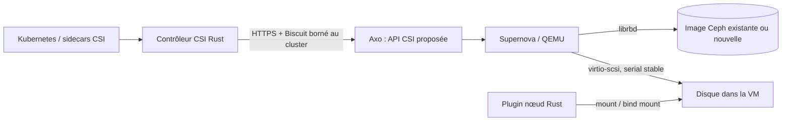

# clever-csi-driver

Driver CSI Clever Cloud en **Rust**, avec un contrôleur HTTP vers Axo et un
plugin nœud Linux. Le même binaire et la même image exécutent les deux rôles.

Le code du driver, le chart Helm et les manifestes Axo sont fournis ici.
**Les nouvelles routes Axo sont un contrat proposé, pas des routes déjà
disponibles.** Le contrôleur reste non prêt tant que le backend n'annonce pas ce
contrat. Le branchement réel via Supernova exige encore cette intégration côté
plateforme ; aucun code Axo ou Supernova n'est modifié par ce dépôt.



## Capacités

- CSI v1.12.0, protocole upstream conservé dans `proto/`.
- Création, suppression, adoption par handle opaque, attachement/détachement,
  validation des capacités et agrandissement.
- Snapshots : création, suppression, liste paginée, restauration ; clone de
  volume via Axo.
- XFS et ext4 préformatés, ainsi que volumes Block. Accès à un seul nœud ; pas
  de montage partagé RWX ni de chiffrement géré par ce driver.
- Stage/publish/unpublish/unstage, statistiques et expansion Linux.
- État nœud persisté et synchronisé sur disque, verrou de processus, contrôles
  de l'identité du disque et du montage avant démontage, refus des chemins
  extérieurs à kubelet et des symlinks.
- Découverte du disque par numéro de série exact, jamais par l'ordre `/dev/sdX`.
- Aucun accès Ceph ni credential Axo dans le plugin nœud. Le contrôleur relit
  son jeton projeté à chaque requête pour permettre sa rotation.

`ListVolumes`, `GetCapacity`, modification des attributs, topologie et snapshots
de groupe ne sont pas annoncés. Les erreurs et capacités non prises en charge
sont explicites. Consulter [le contrat Axo](docs/axo-api.md) pour les garanties
de backend indispensables à chaque opération.

## Choix conservés et corrections du brouillon

Le nom CSI reste **`rbd.csi.ceph.com`** pour préserver les PV/PVC, StorageClass
`csi-rbd-sc`, snapshots et handles existants. Il est configurable pour les tests
isolés. Le nom du dépôt et de l'image est `clever-csi-driver`.

Le nouveau plugin cible les nœuds portant
**`clever-cloud.com/csi: supernova`**. Les anciens et nouveaux plugins doivent
avoir des affinités disjointes ; il ne faut jamais changer ce label sur un nœud
qui conserve des montages de l'autre implémentation. Le contrôleur est un
Deployment dans `kube-system`, avec un Biscuit restreint à l'organisation et au
cluster ; les contrôles d'appartenance et de fencing restent dans Axo.

Le driver ne formate **jamais** un disque. Un `blkid` vide n'est pas une preuve
qu'un volume est neuf. Axo doit initialiser une nouvelle image hors ligne, sous
propriété exclusive, avant de la rendre disponible. Une image adoptée doit
conserver ses données et son système de fichiers. Les images Block restent
brutes. Cette exigence remplace le formatage implicite envisagé dans le brouillon.

Pendant la coexistence, Axo reconnaît les identifiants historiques de ceph-csi
pour le chemin `legacy-krbd`. Ils ne sont jamais utilisés pour cibler une VM
QEMU. Le nouveau plugin requiert un **identifiant d'incarnation de VM fourni par
la plateforme**, dans `/etc/clever-csi/node-id`.

## Compiler et tester

Rust 1.90.0 est fixé dans `rust-toolchain.toml`. Le compilateur protobuf est
fourni par les dépendances de build, sans installation système de `protoc`.

```sh
cargo fmt --all -- --check
cargo clippy --all-targets --locked -- -D warnings
cargo test --all-targets --locked
cargo build --release --locked
docker build -t clever-csi-driver:dev .
# Montages Linux réels dans un conteneur Docker privilégié jetable :
bash deploy/test_linux.sh
```

Les tests de contrat utilisent un serveur Axo simulé. Les tests nœud vérifient
notamment la reprise, l'exclusivité, le mode lecture seule et le refus d'un
formatage implicite. [Le rapport de validation](docs/validation.md) distingue
ces résultats des validations d'infrastructure encore nécessaires.

## Exécution

```sh
clever-csi-driver --mode controller \
  --axo-url https://api.clever-cloud.com \
  --organisation-id orga_example --cluster-id kubernetes_example \
  --axo-token-file /etc/clever-csi/token

clever-csi-driver --mode node \
  --node-id-file /etc/clever-csi/node-id \
  --node-state-dir /var/lib/clever-csi
```

Socket par défaut : `unix:///csi/csi.sock`. Le plugin nœud s'exécute privilégié,
avec les montages hôte décrits dans le chart. `/healthz` indique que le processus
répond ; `/readyz` et CSI `Probe` indiquent l'initialisation du rôle. Le rôle
contrôleur vérifie périodiquement les capacités de l'API Axo. Les sondes HTTP
écoutent sur `:9808` ; elles ne donnent accès à aucune opération CSI.

Les options sont disponibles via `--help` et les variables `CSI_*`. HTTPS est
obligatoire hors tests explicitement démarrés avec `--allow-insecure-http` ;
la vérification des certificats n'est jamais désactivée.

## Livrer et déployer

La CI GitHub Actions teste Rust et le packaging. Elle construit puis publie
l'image **`ghcr.io/clevercloud/clever-csi-driver`** sur les événements de livraison
configurés ; les pull requests ne publient pas d'image. Aucun jeton personnel
n'est nécessaire : le workflow utilise `GITHUB_TOKEN`.

Le [chart Helm](charts/clever-csi-driver) sert aussi de source aux
[manifestes ordonnés pour Axo](deploy/). Par défaut, le contrôleur est désactivé
et le plugin nœud attend le nouveau pool. Le chart ne prend pas possession des
PV/PVC, StorageClass, CSIDriver, Secrets ou CRD snapshots existants.

Suivre [le guide d'exploitation et de migration](docs/operations.md), qui
décrit les phases de prise en charge, les baux des sidecars, l'intégration au
catalogue Axo et les préconditions du nouveau noyau `linux-vm:kube`.

La migration réelle doit attendre le contrat Axo, la validation sur QEMU/KVM et
un canari avec démontage confirmé ou fencing. Les résultats de l'ancien labo
ne prouvent pas ces étapes. La correction du roll global ou des VM jumelles
reste un travail de plateforme distinct.
