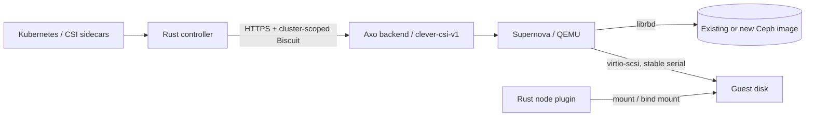

# clever-csi-driver

Clever Cloud CSI driver written in **Rust**, with an Axo-backed controller and a
Linux node plugin. Both roles use the same binary and container image.

This repository provides the driver, Helm chart and manifests for Axo.
**The current controller implements the historical `clever-csi-v1` HTTP
contract ([wire specification](docs/axo-api-v1.md), implementation baseline
`339e7f0`).** It reports readiness only when
the backend advertises that contract's required capabilities. The corresponding
Axo/Supernova backend still requires implementation and integration validation.

The [REST API proposal dated 2026-10-13](docs/axo-api.md) and its
[OpenAPI document](docs/axo-openapi.yaml) describe the next contract. **Neither
the current client nor Axo implements this proposal.** See the
[client migration requirements](docs/axo-api.md#client-migration) before pairing
the driver with a server implementing it.



## Supported operations

- CSI v1.12.0, with the upstream protocol preserved in `proto/`.
- Volume creation, deletion, adoption by opaque handle, attachment, detachment,
  capability validation and expansion.
- Snapshot creation, deletion, pagination and restoration; volume cloning.
- Preformatted XFS/ext4 filesystems and raw Block volumes, with single-node
  access. Shared multi-node mounting and driver-managed encryption are unsupported.
- Node stage, publish, unpublish, unstage, statistics and expansion.
- Durable node state, process locking, mount ownership checks and recovery after
  device re-enumeration when no conflicting mounts remain.
- Disk discovery by exact serial, independent of `/dev/sdX` enumeration order.
- No Ceph client or Axo token is needed by the node plugin. Existing PV Secret
  references can still make kubelet deliver cephx credentials in CSI requests;
  the driver ignores them. The controller rereads its projected Axo token.

`ListVolumes`, `GetCapacity`, mutable volume attributes, topology and group
snapshots are not advertised. See the [Axo REST proposal](docs/axo-api.md) and
[OpenAPI proposal](docs/axo-openapi.yaml) for the target backend design;
these documents are not the wire contract implemented by the current binary.

## Migration and storage requirements

The driver retains **`rbd.csi.ceph.com`** to preserve existing PVs/PVCs,
StorageClass `csi-rbd-sc`, snapshots and volume handles. A separate name can be
configured for isolated tests.

New node plugins target **`clever-cloud.com/csi: supernova`**. Legacy and new
plugins require disjoint node affinities. Never switch a live node's label while
it retains mounts from the other implementation. The controller runs in
`kube-system` with an organisation- and cluster-scoped Biscuit; Axo must enforce
ownership, incarnation identity and fencing.

The driver **never formats a disk**. Axo must initialize new filesystem images
under exclusive ownership before attachment. Adopted images retain their data
and filesystem; an empty `blkid` result is not evidence that formatting is safe.
Block volumes remain raw.

The current client requires Axo to route historical ceph-csi node IDs through
`legacy-krbd`. New nodes require a platform-provided VM incarnation ID in
`/etc/clever-csi/node-id`. QEMU `scsi-hd` serials must match
`[A-Za-z0-9._-]{1,36}` and remain distinct from opaque volume handles.

Filesystem publications retain all applicable read-only constraints. A read-only
Block publication requires a read-only attachment and a guest device confirmed
read-only; a read-only bind mount alone cannot enforce this. Filesystem mounts
use `nosuid,nodev` in the driver's mount namespace; container-runtime bind mounts
can change the effective flags seen inside the pod. Review these policies in the
[operations guide](docs/operations.md#mount-and-recovery-policy) before migration.

## Build and test

Rust 1.90.0 is pinned in `rust-toolchain.toml`. The build dependencies provide
`protoc`; a separate system installation is unnecessary.

```sh
cargo fmt --all -- --check
cargo clippy --all-targets --locked -- -D warnings
cargo test --all-targets --locked
cargo build --release --locked
docker build -t clever-csi-driver:dev .
# Real Linux mounts in a disposable privileged Docker container:
bash deploy/test_linux.sh
# CSI conformance against a local Axo fixture and real Linux loop devices:
bash deploy/test_linux.sh sanity
```

Controller contract tests use a mock Axo server for the historical
`clever-csi-v1` contract. They do not validate the REST proposal. Node tests cover
recovery, ownership, read-only access and refusal to format unknown disks. The
[validation report](docs/validation.md) separates these checks from platform
integration tests still required before rollout.

## Run

```sh
clever-csi-driver --mode controller \
  --axo-url https://api.clever-cloud.com \
  --organisation-id orga_example --cluster-id kubernetes_example \
  --axo-token-file /etc/clever-csi/token

clever-csi-driver --mode node \
  --node-id-file /etc/clever-csi/node-id \
  --node-state-dir /var/lib/clever-csi
```

The default socket is `unix:///csi/csi.sock`. The node plugin runs privileged
with the host mounts specified in the chart. `/healthz` checks process health;
`/readyz` and CSI `Probe` report role readiness. The controller periodically
checks Axo capabilities. HTTP probes listen on `:9808` and expose no CSI operations.

Options are available through `--help` and `CSI_*` environment variables. HTTPS
is required except in tests explicitly using `--allow-insecure-http`; certificate
verification is always enabled.

## Release and deploy

GitHub Actions tests Rust, Linux storage operations and deployment packaging,
then builds and smoke-tests the image. Release jobs publish that same image to
**`ghcr.io/clevercloud/clever-csi-driver`** using `GITHUB_TOKEN`. Pull requests
do not publish images.

The [Helm chart](charts/clever-csi-driver) is also the source of the
[ordered manifests for Axo](deploy/). The controller is disabled by default;
node plugins wait for the new pool. Existing PVs/PVCs, StorageClasses, CSIDriver,
Secrets and snapshot CRDs remain under their current ownership.

Follow the [operations and migration guide](docs/operations.md) for controller
handoffs, sidecar leases, Axo catalog integration and the `linux-vm:kube` kernel
profile. A real migration requires a compatible driver/backend contract,
QEMU/KVM validation and a canary with confirmed unmount or fencing. The earlier
krbd laboratory results do not validate this attachment path.
